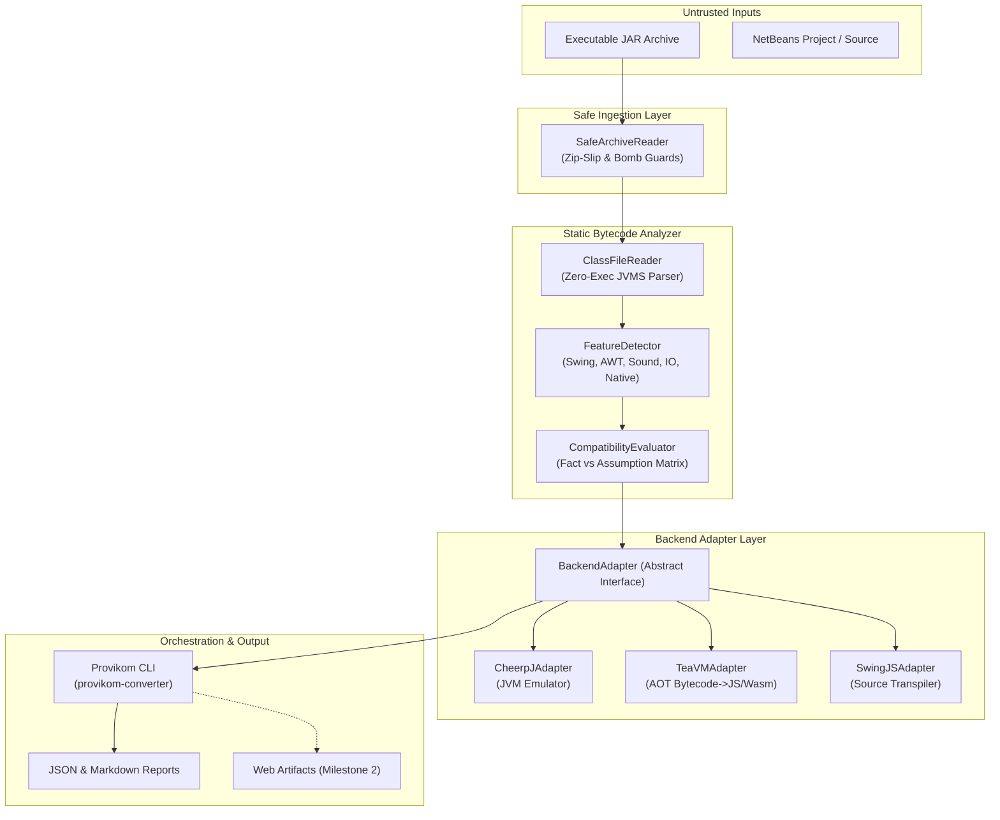

# Provikom Converter - System Architecture Document

## 1. Overview & Mission

**Provikom Converter** is an open-source publishing tool designed to analyze Java game projects and executable JAR archives, determine browser runtime and compiler compatibility, and generate playable web artifacts.

The project originated as an architectural evolution of `AsistenProvikom/project-2024`, a curated gallery of seven Java games that originally relied on CheerpJ 5.0. Provikom Converter abstracts runtime backends into a modular, pluggable architecture while introducing a rigorous zero-execution analysis pipeline for untrusted archives.

---

## 2. Core Architectural Principles & Constraints

1. **Zero Host Execution of Game Code:**
   Untrusted game code is never executed, instantiated, or dynamically linked on the host machine or analysis runner. All static analyses operate strictly via binary byte parsing.
2. **Never Confuse Analysis with Execution:**
   Successful bytecode analysis does not guarantee browser runtime execution. Reports explicitly differentiate between verified capabilities (grounded in bytecode data) and runtime assumptions/risks (e.g., audio autoplay policies, timing loops, or memory consumption).
3. **Pluggable & Decoupled Backends:**
   Backends (CheerpJ, TeaVM, SwingJS) are isolated behind standard adapter interfaces. The core analyzer has no compile-time coupling to any single conversion engine.
4. **Resilience to Malicious Archives:**
   Archive readers enforce strict guards against Zip-Slip path traversal, decompression bombs (zip bombs), and excessive entry counts.
5. **No Heavy Infrastructure for Milestone One:**
   No databases, dashboards, microservices, or authentication tiers. The tool is CLI-first and produces standard, reproducible JSON and Markdown reports.

---

## 3. High-Level System Architecture



---

## 4. Component Breakdown

### 4.1 Analyzer Module (`provikom_converter.analyzer`)
- **`archive.py` (`SafeArchiveReader`)**:
  - Validates entry names against directory traversal vectors (`../`, `/`, Windows drive specifiers `C:`).
  - Enforces total uncompressed size limits (default 500 MB) and maximum entry count (50,000 entries).
  - Flags abnormal compression ratios (>100:1) and discovers nested embedded archives.
  - Parses RFC 822 folded `META-INF/MANIFEST.MF` lines, extracting `Main-Class` and `Class-Path`.
- **`bytecode.py` (`ClassFileReader`)**:
  - Implements binary parsing of JVM classfiles per the Java Virtual Machine Specification (JVMS).
  - Extracts major/minor class versions (Java 8 up to Java 25).
  - Resolves constant pool symbols: `Utf8`, `Class`, `Methodref`, `Fieldref`, `NameAndType`, `String`, etc.
  - Identifies superclasses, implemented interfaces, method access flags (including `ACC_NATIVE`).
- **`rules.py` (`FeatureDetector`)**:
  - Categorizes referenced classes and method signatures into structured features:
    - **GUI**: Swing (`javax/swing/*`), AWT (`java/awt/*`), JavaFX (`javafx/*`), SWT (`org/eclipse/swt/*`).
    - **Audio**: Java Sound Sampled (`javax/sound/sampled/*`), MIDI (`javax/sound/midi/*`).
    - **Concurrency**: `Thread`, `Runnable`, `java.util.concurrent.*`.
    - **I/O & Persistence**: `java.io.File`, `java.nio.file.*`.
    - **Networking**: Raw sockets vs URL resource lookups.
    - **Reflection**: `java.lang.reflect.*`, `sun.misc.Unsafe`.
    - **Dependencies**: NetBeans `AbsoluteLayout` and `AbsoluteConstraints`.
    - **Native Code**: Native methods or `System.loadLibrary`.
- **`compatibility.py` (`CompatibilityEvaluator`)**:
  - Evaluates detected features against known capabilities and limitations of each backend.
  - Produces structured evaluations containing `status`, `confidence_score`, `verified_capabilities`, `assumptions_and_risks`, `blockers`, `workarounds_needed`, and `remediation_steps`.

---

## 5. Backend Adapter Interface Specification

All backends implement the `BackendAdapter` abstract base class defined in `provikom_converter.adapters.base`:

```python
class BackendAdapter(ABC):
    @property
    @abstractmethod
    def backend_id(self) -> str: ...

    @property
    @abstractmethod
    def display_name(self) -> str: ...

    @property
    @abstractmethod
    def is_open_source(self) -> bool: ...

    @property
    @abstractmethod
    def supports_bytecode_input(self) -> bool: ...

    @property
    @abstractmethod
    def supports_source_input(self) -> bool: ...

    @abstractmethod
    def evaluate_compatibility(
        self,
        inventory: ArchiveInventory,
        features: AnalysisFeatures,
        class_major_versions: List[int],
    ) -> BackendEvaluation: ...

    @abstractmethod
    def create_conversion_plan(
        self,
        inventory: ArchiveInventory,
        features: AnalysisFeatures,
        class_major_versions: List[int],
        options: ConversionOptions,
    ) -> ConversionPlan: ...

    @abstractmethod
    def get_runtime_dependencies(self) -> List[str]: ...
```

---

## 6. Comparison of Candidate Backends

| Dimension | CheerpJ 5.0 | TeaVM | SwingJS / Java2Script |
|---|---|---|---|
| **Underlying Mechanism** | Full client-side JVM emulator (Wasm + JS OpenJDK) | Ahead-of-Time (AOT) bytecode-to-JS/Wasm compiler | Source-level Java-to-JavaScript transpiler & runtime |
| **License** | Proprietary / Commercial | Open Source (Apache 2.0) | Open Source (GPLv2+CE / BSD) |
| **Accepted Input** | Executable `.jar` bytecode directly | `.class` / `.jar` bytecode | Java source code (`.java`) |
| **Supported Bytecode Versions** | Java 8 through Java 25 (v69) | Java 8 through Java 21+ bytecode | N/A (Requires Java 8/11 source syntax) |
| **Desktop Swing / AWT** | **Full Support** (Canvas-rendered) | **Unsupported** (no Swing/AWT classes) | **Full Support** (DOM & Canvas-rendered) |
| **Java Sound (`javax.sound`)** | **Supported** (Web Audio API) | **Unsupported** in core | **Partial Support** (HTML5 Audio) |
| **Multi-threading** | Simulated via Wasm stack-switching | Asynchronous CPS / event loop | Single-threaded JavaScript event loop |
| **Bundle Size & Overhead** | Heavy (~15-30 MB initial CDN load) | Lightweight (~200 KB - 2 MB self-contained) | Moderate (~1 - 5 MB static JS) |
| **Offline Deployment** | Requires enterprise self-hosting package | Fully offline capable | Fully offline capable |
| **Verdict for `project-2024`** | **Immediate Production Target** | Incompatible for unmodified Swing games | **Viable Open-Source Target via Decompilation** |

---

## 7. Security Architecture & Threat Model

### 7.1 Untrusted Archive Ingestion
- Uploaded game JARs are treated as untrusted, potentially hostile data.
- **Zip-Slip Protection**: Entry paths with parent traversals (`../`) or root prefixes (`/`, `C:\`) are rejected before any stream read.
- **Zip Bomb Mitigation**:
  - Max entry count capped at 50,000.
  - Cumulative uncompressed byte stream capped at 500 MB.
  - Compression ratios exceeding 100:1 trigger audit alerts.
- **Bytecode Parser Isolation**: The class parser reads binary buffers in-memory using struct unpackers; no class loading (`ClassLoader.defineClass`) or execution takes place.

### 7.2 CI/CD Runner Security
- Untrusted contributions and pull requests must **never** run on self-hosted lab runners with access to internal network zones.
- Analysis workflows run strictly inside isolated, ephemeral GitHub-hosted runners with no elevated privileges.
