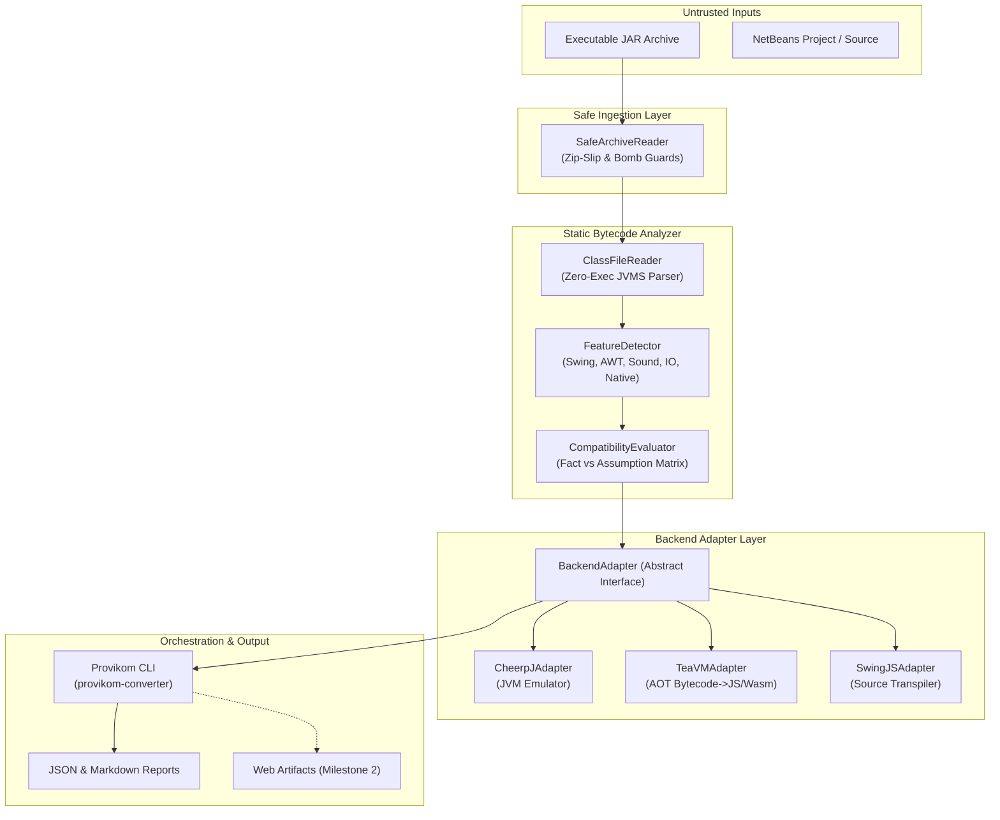

# Provikom Converter - System Architecture Document

## 1. Overview & Mission

**Provikom Converter** is an open-source publishing tool designed to analyze Java game projects and executable JAR archives, determine browser runtime and compiler compatibility, and generate playable web artifacts.

The project originated as an architectural evolution of `AsistenProvikom/project-2024`, a curated gallery of seven Java games that originally relied on CheerpJ 5.0. Provikom Converter abstracts runtime backends into a modular, pluggable architecture while introducing a rigorous zero-execution analysis pipeline for untrusted archives.

---

## 2. Core Architectural Principles & Constraints

1. **Zero Host Execution of Game Code:**
   Untrusted game code is never executed, instantiated, or dynamically linked on the host machine or analysis runner. All static analyses operate strictly via binary byte parsing.
2. **Never Confuse Analysis with Execution:**
   Successful bytecode analysis does not guarantee browser runtime execution. Reports explicitly differentiate between verified capabilities (grounded in bytecode data) and runtime assumptions/risks (e.g., audio autoplay policies, timing loops, or memory consumption).
3. **Pluggable & Decoupled Backends:**
   Backends (CheerpJ, TeaVM, SwingJS) are isolated behind standard adapter interfaces. The core analyzer has no compile-time coupling to any single conversion engine.
4. **Resilience to Malicious Archives:**
   Archive readers enforce strict guards against Zip-Slip path traversal, decompression bombs (zip bombs), and excessive entry counts.
5. **No Heavy Infrastructure for Milestone One:**
   No databases, dashboards, microservices, or authentication tiers. The tool is CLI-first and produces standard, reproducible JSON and Markdown reports.

---

## 3. High-Level System Architecture



---

## 4. Component Breakdown

### 4.1 Analyzer Module (`provikom_converter.analyzer`)
- **`archive.py` (`SafeArchiveReader`)**:
  - Validates entry names against directory traversal vectors (`../`, `/`, Windows drive specifiers `C:`).
  - Enforces total uncompressed size limits (default 500 MB) and maximum entry count (50,000 entries).
  - Flags abnormal compression ratios (>100:1) and discovers nested embedded archives.
  - Parses RFC 822 folded `META-INF/MANIFEST.MF` lines, extracting `Main-Class` and `Class-Path`.
- **`bytecode.py` (`ClassFileReader`)**:
  - Implements binary parsing of JVM classfiles per the Java Virtual Machine Specification (JVMS).
  - Extracts major/minor class versions (Java 8 up to Java 25).
  - Resolves constant pool symbols: `Utf8`, `Class`, `Methodref`, `Fieldref`, `NameAndType`, `String`, etc.
  - Identifies superclasses, implemented interfaces, method access flags (including `ACC_NATIVE`).
- **`rules.py` (`FeatureDetector`)**:
  - Categorizes referenced classes and method signatures into structured features:
    - **GUI**: Swing (`javax/swing/*`), AWT (`java/awt/*`), JavaFX (`javafx/*`), SWT (`org/eclipse/swt/*`).
    - **Audio**: Java Sound Sampled (`javax/sound/sampled/*`), MIDI (`javax/sound/midi/*`).
    - **Concurrency**: `Thread`, `Runnable`, `java.util.concurrent.*`.
    - **I/O & Persistence**: `java.io.File`, `java.nio.file.*`.
    - **Networking**: Raw sockets vs URL resource lookups.
    - **Reflection**: `java.lang.reflect.*`, `sun.misc.Unsafe`.
    - **Dependencies**: NetBeans `AbsoluteLayout` and `AbsoluteConstraints`.
    - **Native Code**: Native methods or `System.loadLibrary`.
- **`compatibility.py` (`CompatibilityEvaluator`)**:
  - Evaluates detected features against known capabilities and limitations of each backend.
  - Produces structured evaluations containing `status`, `confidence_score`, `verified_capabilities`, `assumptions_and_risks`, `blockers`, `workarounds_needed`, and `remediation_steps`.

---

## 5. Backend Adapter Interface Specification

All backends implement the `BackendAdapter` abstract base class defined in `provikom_converter.adapters.base`:

```python
class BackendAdapter(ABC):
    @property
    @abstractmethod
    def backend_id(self) -> str: ...

    @property
    @abstractmethod
    def display_name(self) -> str: ...

    @property
    @abstractmethod
    def is_open_source(self) -> bool: ...

    @property
    @abstractmethod
    def supports_bytecode_input(self) -> bool: ...

    @property
    @abstractmethod
    def supports_source_input(self) -> bool: ...

    @abstractmethod
    def evaluate_compatibility(
        self,
        inventory: ArchiveInventory,
        features: AnalysisFeatures,
        class_major_versions: List[int],
    ) -> BackendEvaluation: ...

    @abstractmethod
    def create_conversion_plan(
        self,
        inventory: ArchiveInventory,
        features: AnalysisFeatures,
        class_major_versions: List[int],
        options: ConversionOptions,
    ) -> ConversionPlan: ...

    @abstractmethod
    def generate_artifact(
        self,
        analysis_result: Any,
        options: BuildOptions,
    ) -> BuildResult: ...

    @abstractmethod
    def get_runtime_dependencies(self) -> List[str]: ...
```

---

## 6. Comparison of Candidate Backends

| Dimension | CheerpJ 5.0 | TeaVM | SwingJS / Java2Script |
|---|---|---|---|
| **Underlying Mechanism** | Full client-side JVM emulator (Wasm + JS OpenJDK) | Ahead-of-Time (AOT) bytecode-to-JS/Wasm compiler | Source-level Java-to-JavaScript transpiler & runtime |
| **License** | Proprietary / Commercial | Open Source (Apache 2.0) | Open Source (GPLv2+CE / BSD) |
| **Accepted Input** | Executable `.jar` bytecode directly | `.class` / `.jar` bytecode | Java source code (`.java`) |
| **Supported Bytecode Versions** | Java 8 through Java 25 (v69) | Java 8 through Java 21+ bytecode | N/A (Requires Java 8/11 source syntax) |
| **Desktop Swing / AWT** | **Full Support** (Canvas-rendered) | **Unsupported** (no Swing/AWT classes) | **Full Support** (DOM & Canvas-rendered) |
| **Java Sound (`javax.sound`)** | **Supported** (Web Audio API) | **Unsupported** in core | **Partial Support** (HTML5 Audio) |
| **Multi-threading** | Simulated via Wasm stack-switching | Asynchronous CPS / event loop | Single-threaded JavaScript event loop |
| **Bundle Size & Overhead** | Heavy (~15-30 MB initial CDN load) | Lightweight (~200 KB - 2 MB self-contained) | Moderate (~1 - 5 MB static JS) |
| **Offline Deployment** | Requires enterprise self-hosting package | Fully offline capable | Fully offline capable |
| **Verdict for `project-2024`** | **Immediate Production Target** | Incompatible for unmodified Swing games | **Viable Open-Source Target via Decompilation** |

---

## 7. Security Architecture & Threat Model

### 7.1 Untrusted Archive Ingestion
- Uploaded game JARs are treated as untrusted, potentially hostile data.
- **Zip-Slip Protection**: Entry paths with parent traversals (`../`) or root prefixes (`/`, `C:\`) are rejected before any stream read.
- **Zip Bomb Mitigation**:
  - Max entry count capped at 50,000.
  - Cumulative uncompressed byte stream capped at 500 MB.
  - Compression ratios exceeding 100:1 trigger audit alerts.
- **Bytecode Parser Isolation**: The class parser reads binary buffers in-memory using struct unpackers; no class loading (`ClassLoader.defineClass`) or execution takes place.

### 7.2 CI/CD Runner Security
- Untrusted contributions and pull requests must **never** run on self-hosted lab runners with access to internal network zones.
- Analysis and browser workflows run strictly inside isolated, ephemeral GitHub-hosted runners with no elevated privileges.
- Workflow permissions are limited to `contents: read`, and checkout credentials are not persisted.
- Game fixtures are checked out from a pinned `project-2024` commit rather than a moving branch.
- Missing fixtures, browser dependencies, or CheerpJ CDN access fail the job; CI does not silently downgrade to skipped verification.

---

## 8. Milestone 2A: CheerpJ Artifact Generation

### 8.1 Build Pipeline

`ConverterPipeline.build_artifact()` reuses the same zero-execution analysis path as `analyze_jar()`, then delegates to the selected backend adapter:

```text
JAR -> SafeArchiveReader -> ClassFileReader -> FeatureDetector
    -> CompatibilityEvaluator -> CheerpJAdapter.generate_artifact()
    -> static web bundle + manifest.json
```

Only `CheerpJAdapter` implements `generate_artifact()` in Milestone 2A. `TeaVMAdapter` and `SwingJSAdapter` satisfy the interface but raise `NotImplementedError` so unsupported backends cannot silently produce incomplete bundles.

### 8.2 Generated Artifact Model

```text
<output>/
├── index.html          # Accessible player shell and overlays
├── style.css           # Responsive player layout
├── app.js              # CheerpJ runtime controller
├── manifest.json       # Build metadata and compatibility record
├── <Game>.jar          # Unmodified input archive
└── lib/                # Staged manifest Class-Path dependencies
```

The web root is served directly. CheerpJ assets are mounted under `/app/`, so the main JAR resolves to `/app/<Game>.jar` and a dependency such as `lib/AbsoluteLayout.jar` resolves to `/app/lib/AbsoluteLayout.jar`.

### 8.3 Runtime Selection

| Bytecode major | CheerpJ runtime | Stability |
|---:|---|---|
| 45-52 | Java 8 | Stable |
| 53-65 | Java 21 LTS | Stable |
| 66 | Java 25 preview candidate | Experimental |
| < 45 or > 66 | Rejected | Unsupported |

The generated manifest records the runtime version, label, selection reason, and experimental flag. The player displays an experimental badge when applicable.

### 8.4 Dependency Resolution and Staging

For each manifest `Class-Path` entry:

1. Normalize separators and remove leading `./` segments.
2. Reject URLs, absolute paths, and `..` traversal.
3. Search the source JAR directory, its parent, and adjacent `lib/` locations.
4. Copy the dependency into the bundle at the same relative path.
5. Add the dependency's `/app/...` path to the explicit CheerpJ classpath.
6. Record relative path, virtual path, size, and SHA-256 in `manifest.json`.

Missing or unsafe dependencies fail the build before any bundle is written.

### 8.5 Browser-Side Runtime Flow

```text
User clicks Launch
  -> cheerpjInit({ version, status: "none" })
  -> HEAD-check main JAR and staged dependencies
  -> cheerpjCreateDisplay(-1, -1, #cheerpj-display)
  -> cheerpjRunMain(mainClass, classPath.join(":"))
       (fallback: cheerpjRunJar(jarVirtualPath))
  -> set data-status = running | exited | error
```

The player:

- Requires a user gesture before initializing, so audio unlock policies are satisfied.
- Buffers console output to detect Java exceptions (`ExceptionInInitializerError`, `NoClassDefFoundError`, `No line matching interface`, and similar patterns).
- Shows a diagnostics overlay with a copyable stack trace.
- Escapes all archive-derived text before HTML insertion.
- Serializes runtime configuration with `json.dumps`.

### 8.6 Safe Transactional Artifact Publishing

`--force` artifact replacement is destructive by nature. `provikom_converter.build_safety` validates paths before any deletion and publishes completed builds atomically:

```text
validate source/output relationship
  -> reject parent-directory traversal
  -> reject source JAR, source parent, source ancestors, filesystem roots, and symlinks
  -> require non-empty existing targets to carry a Provikom manifest
  -> create temporary sibling directory
  -> generate artifact
  -> atomically rename temporary directory into place
  -> preserve previous artifact on failure
```

The adapter passes the caller's raw output path into the safety layer; it does not call `resolve()` first, because resolving a symlink before validation would hide the symlink and bypass rejection. Existing artifacts are renamed to a backup only after the new build has completed. If publishing fails, the backup is restored. Temporary directories are removed on both success and failure paths.

### 8.7 Lifecycle and Verification Evidence

`provikom_converter.lifecycle` keeps three questions separate:

1. What does static analysis predict? (`compatibility` blocks)
2. Did artifact generation succeed? (`lifecycle.state = built`)
3. Did the game actually render and respond in a browser? (`runtime_verified` or `failed`)

A mounted canvas is not runtime verification. Only a verification record with browser checks can promote an artifact. Evidence is written to `verification.json` and referenced from the manifest lifecycle block. The static compatibility prediction is never rewritten by browser results.

### 8.8 HTTP Range Serving

`provikom_converter.server.RangeRequestHandler` extends `SimpleHTTPRequestHandler` with:

- `Accept-Ranges: bytes` on all responses.
- Single-range `206 Partial Content` support for `bytes=start-end`, `bytes=start-`, and `bytes=-suffix`.
- `416 Range Not Satisfiable` for invalid or out-of-bounds ranges.
- Correct `Content-Range`, `Content-Length`, and `Last-Modified` headers.
- HTTP/1.1 keep-alive behavior and CORS headers.
- Optional access logging via `PROVIKOM_HTTP_LOG=1`.

This server is a development/preview convenience. Production deployments can use any static host that supports Range Requests.

---

## 9. Browser Verification Architecture

The browser harness in `tests/test_browser_smoke.py` launches headless Chromium through Playwright, serves generated bundles through `RangeRequestHandler`, and verifies:

- No uncaught page errors during load.
- The visible main canvas mounts within a bounded timeout.
- Pillow analyzes canvas screenshots for color diversity, luminance variance, non-dark content, and game-specific color distributions.
- CarTraffic character selection and NEXT navigation produce a visible UI change.
- Flappy PLAY navigation produces a visible gameplay change.
- PaddleGame level selection starts the Easy mode game UI and its `AbsoluteLayout.jar` dependency is served with Range support.
- PongGame surfaces its known `No line matching interface Clip` Java error.
- Console diagnostics, screenshots, and lifecycle evidence are retained.
- Build output exists and non-empty overwrite protection works.

Evidence records are written to `docs/verification/<game>.json`; screenshots are written to `docs/screenshots/`. The Pong artifact is intentionally retained under `build/verification/pong` for debugging.

Strict mode is required in CI:

- `PROVIKOM_REQUIRE_FIXTURES=1` makes missing fixtures fatal.
- `PROVIKOM_REQUIRE_BROWSER=1` makes missing Playwright/Pillow/CDN access fatal.
- `PROVIKOM_SKIP_BROWSER=1` is a local convenience only and is never used by the browser CI job.

---

## 10. Known Runtime Limitations

- **PongGame:** 8-bit mono 44.1 kHz WAV audio is rejected by browser `Clip` support. The player surfaces `No line matching interface Clip ...` as a Java Runtime Error and the lifecycle remains `failed`. This is a game/runtime audio compatibility limitation, not a packaging defect.
- **PaddleGame:** logs non-fatal `mark/reset not supported` audio exceptions; rendering and interaction still work.
- **Flappy:** keyboard events were dispatched after canvas focus in the headless harness, but the local run showed no visual delta. PLAY navigation is the asserted interaction; the verification record preserves the raw keyboard evidence ratio.
- **Java 22:** requires the experimental Java 25 preview runtime.
- **CheerpJ:** is proprietary and requires CDN access unless a vendor-supported self-hosted/enterprise package is used.
- **Startup latency:** large archives can take roughly 15 seconds to mount a canvas in headless Chromium.
- **Milestone scope:** TeaVM and SwingJS artifact generation remain unimplemented.

---

## 11. Security Invariants Preserved

- Game code is never executed on the host during analysis; analysis remains binary parsing only.
- Input JARs are copied unchanged into artifacts.
- Archive traversal, zip bombs, excessive entry counts, and abnormal compression ratios remain guarded.
- Artifact output paths are validated against the source JAR before `--force` deletion.
- Builds publish atomically and preserve prior artifacts when generation fails.
- Output paths for staged dependencies are checked to remain inside the artifact directory.
- Generated HTML escapes untrusted archive strings.
- Browser verification runs in headless Chromium on ephemeral GitHub-hosted runners.
- Untrusted pull requests must not run on privileged self-hosted runners.
