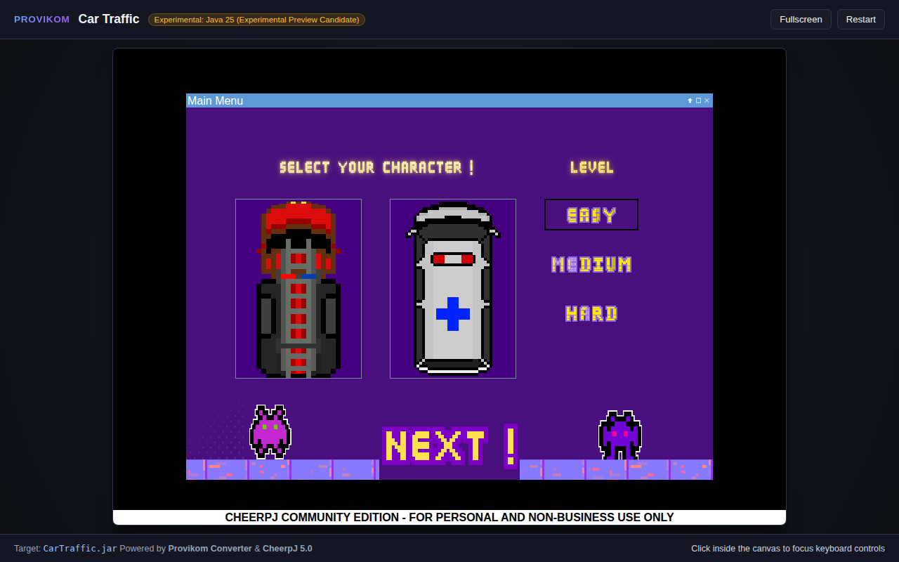
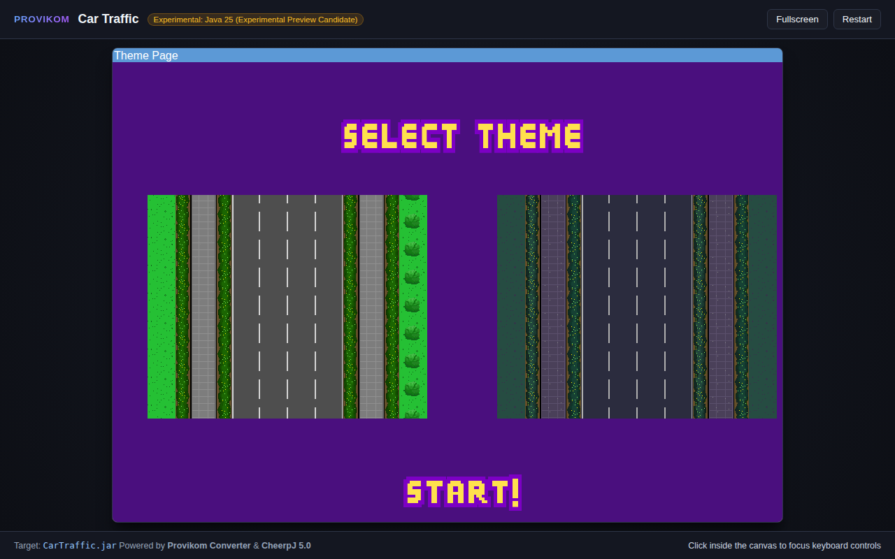
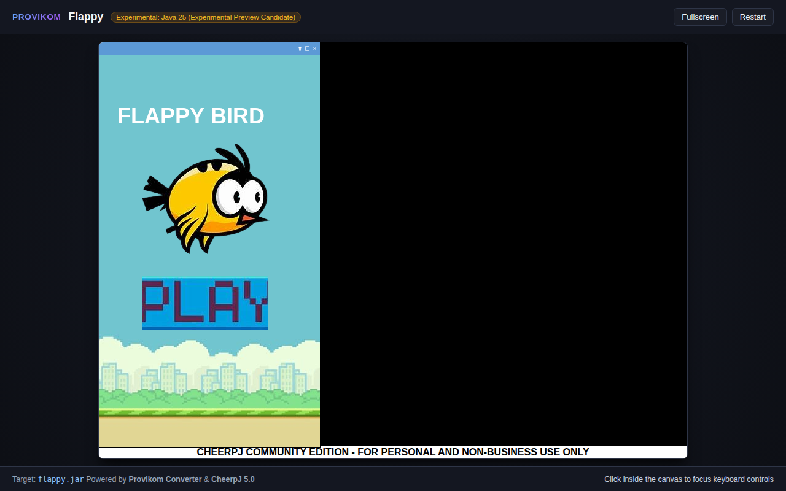
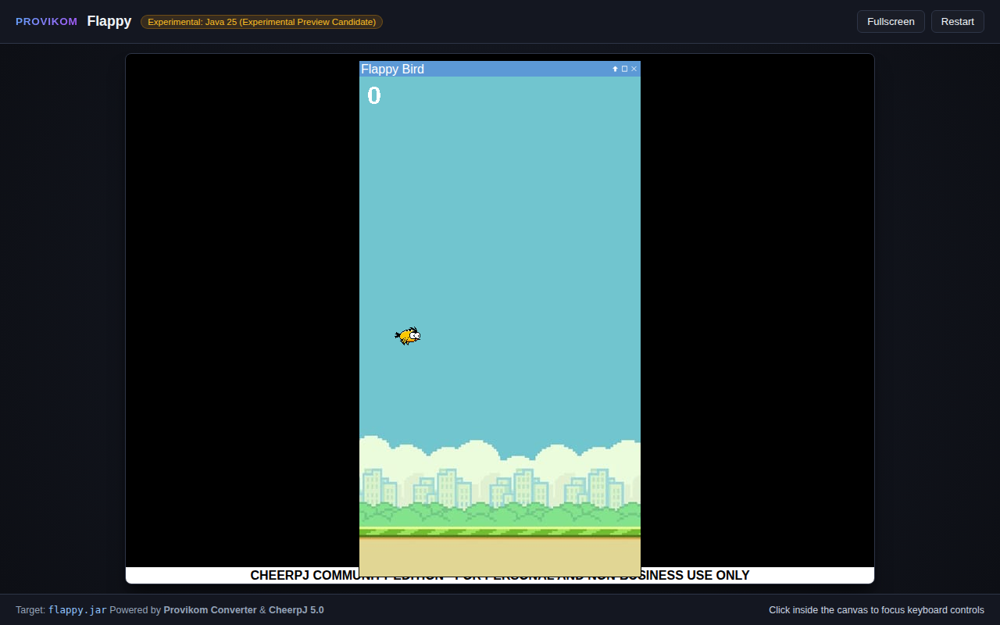
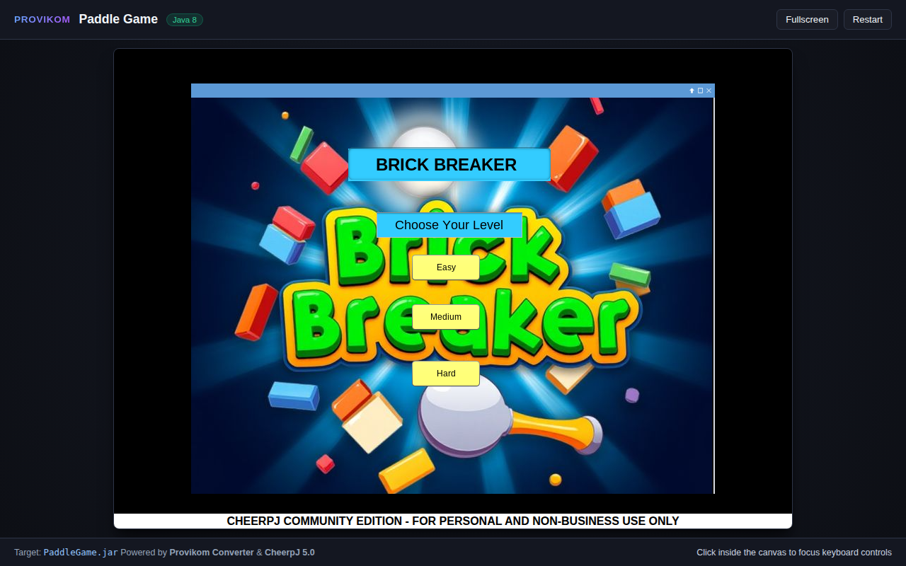
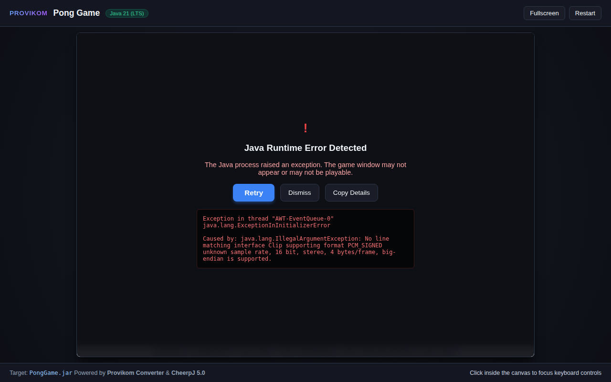

# Milestone 2A Report - CheerpJ 5.0 Playable Web Artifacts

**Status:** Complete
**Branch:** `milestone-2a-cheerpj-builder`
**Scope:** Automated generation and browser verification of playable CheerpJ 5.0 web artifacts for unmodified Java game JARs.

---

## 1. What Was Built

Milestone 2A adds a complete artifact-generation path to Provikom Converter:

```bash
python3 -m provikom_converter build <input.jar> \
  --backend cheerpj \
  --output <directory> \
  [--title "Custom Title"] \
  [--force]
```

The generated directory is a static web bundle that can be served by any HTTP server with Range Request support:

```bash
python3 -m provikom_converter serve <directory> --port 8080
```

### Generated bundle layout

| File | Purpose |
|---|---|
| `index.html` | Player shell, start/loading/error overlays, accessible controls |
| `style.css` | Responsive dark player UI, fullscreen layout, overlays |
| `app.js` | CheerpJ initialization, dependency checks, runtime launch, diagnostics |
| `manifest.json` | Reproducible build metadata, runtime selection, compatibility data |
| `<Game>.jar` | Original input archive, copied unchanged |
| `lib/<dependency>.jar` | Staged `Class-Path` dependencies, preserving manifest-relative paths |

`--force` removes stale files before writing. Without it, a non-empty output directory is rejected.

---

## 2. Runtime Selection

CheerpJ 5.0 supports specific Java runtime targets. The builder maps class-file major versions deterministically:

| Input bytecode | Major version | CheerpJ runtime | Status |
|---|---:|---|---|
| Java 8 and older (>= Java 1.1) | 45-52 | Java 8 | Stable |
| Java 9 through Java 21 | 53-65 | Java 21 LTS | Stable |
| Java 22 | 66 | Java 25 preview candidate | Experimental |
| Invalid (< 45) or newer than Java 22 | < 45 or > 66 | - | Rejected |

The selected runtime, the mapping reason, and whether the target is experimental are recorded in `manifest.json` and printed by the CLI.

---

## 3. Player Shell and Runtime Behavior

- Loads the official CheerpJ 5.0 CDN loader: `https://cjrtnc.leaningtech.com/5.0/loader.js`.
- Calls `cheerpjInit({ version })`, `cheerpjCreateDisplay(...)`, and `cheerpjRunMain(mainClass, classPath)`.
- Falls back to `cheerpjRunJar` when no `Main-Class` can be resolved.
- Mounts assets under `/app/` and verifies required files with a reachability check before launch.
- Starts only after a user gesture, satisfying browser audio autoplay policies.
- Surfaces startup failures and Java exceptions in an in-page error overlay with copyable details.
- Reports compatibility notes on the launch screen, including experimental runtime warnings.
- Escapes all archive-derived strings before inserting them into HTML.
- Exposes runtime state through `document.body.dataset.status` for automated testing (`idle`, `initializing`, `running`, `error`, `exited`).

---

## 4. Dependency Staging

Manifest `Class-Path` entries are resolved locally and copied into the bundle:

- Paths are normalized and validated.
- Absolute paths, URLs, and `..` traversal are rejected.
- The original relative dependency layout is preserved (`lib/AbsoluteLayout.jar` -> `/app/lib/AbsoluteLayout.jar`).
- Staged dependencies are added to the explicit CheerpJ classpath and recorded with SHA-256 hashes in `manifest.json`.
- Missing dependencies fail the build with a clear error instead of producing a broken bundle.

Verified case: `PaddleGame.jar` declares `Class-Path: lib/AbsoluteLayout.jar`; the builder stages it automatically and the game launches without manual edits.

---

## 5. HTTP Serving

`provikom serve` uses a custom HTTP/1.1 handler that adds:

- `Accept-Ranges: bytes` on responses.
- RFC 7233 `206 Partial Content` responses for `Range: bytes=...` requests.
- `416 Range Not Satisfiable` with `Content-Range: bytes */<size>` for invalid ranges.
- Correct `Content-Length` and directory index handling.
- CORS headers for local development and embedded previews.
- Optional request logging via `PROVIKOM_HTTP_LOG=1`.

Range support is required in practice because CheerpJ may request JAR data in chunks rather than downloading the entire archive at once.

---

## 6. Browser Verification Results

Browser tests run in headless Chromium through Playwright. They require:

- The `playwright` Python package and a Chromium browser.
- Network access to the CheerpJ CDN.
- The local `project-2024` game JARs.

Set `PROVIKOM_SKIP_BROWSER=1` to skip browser classes in offline environments.

### Verified games

| Game | Bytecode | Runtime | Dependencies | Result |
|---|---|---|---|---|
| `CarTraffic.jar` | Java 22 (66) | Java 25 experimental | None | Menu renders; character selection and `NEXT` navigation produce the theme page |
| `flappy.jar` | Java 22 (66) | Java 25 experimental | None | Menu renders; click starts the game; game-over dialog appears after input |
| `PaddleGame.jar` | Java 8 (52) | Java 8 | `lib/AbsoluteLayout.jar` | Level select renders; `Easy` starts the brick-breaker frame; audio warnings are non-fatal |
| `PongGame.jar` | Java 21 (65) | Java 21 LTS | None | JVM starts, but browser audio cannot open the game's Clip format; the player surfaces the Java exception |

The Pong failure is a known runtime limitation, not a packaging failure. The generated player correctly detects the Java exception and shows the diagnostics overlay.

### Screenshots

| Screenshot | Description |
|---|---|
| `screenshots/cartraffic_initial.png` | Launch overlay for CarTraffic |
| `screenshots/cartraffic_running.png` | CarTraffic character/level menu |
| `screenshots/cartraffic_interaction.png` | CarTraffic theme selection after `NEXT` |
| `screenshots/flappy_menu.png` | Flappy Bird menu |
| `screenshots/flappy_running.png` | Flappy Bird gameplay after launch |
| `screenshots/flappy_interaction.png` | Flappy Bird game-over dialog |
| `screenshots/paddle_running.png` | Brick Breaker level selection |
| `screenshots/paddle_interaction.png` | Brick Breaker frame after choosing `Easy` |
| `screenshots/pong_audio_error.png` | Pong Java Runtime Error overlay with audio exception details |








---

## 7. Automated Test Coverage

### Core suite (no browser)

```bash
PROVIKOM_SKIP_BROWSER=1 python3 -m unittest discover -s tests -v
```

Covers:

- Runtime selection boundaries (Java 8, Java 9-21, Java 22, unsupported versions).
- Artifact generation structure and manifest round-tripping.
- `/app/` mount and official CheerpJ API usage.
- HTML escaping and safe JSON configuration.
- Original JAR preservation.
- Dependency staging, missing dependencies, and traversal rejection.
- Force-overwrite and non-empty output directory behavior.
- Adapter contract for CheerpJ, TeaVM, and SwingJS.
- HTTP Range requests: full, HEAD, prefix, suffix, open-ended, and unsatisfiable.
- CLI analyze/build/serve/schema behavior.

### Full suite (browser enabled)

```bash
python3 -m unittest discover -s tests -v
```

Adds the Playwright browser tests covering:

- Static asset serving and Range-served JARs.
- Canvas mounting for CarTraffic, PaddleGame, and flappy.
- Keyboard input after focusing the canvas.
- Paddle dependency loading through `/app/lib/AbsoluteLayout.jar`.
- Pong's known audio exception surfacing in the player overlay.
- CLI build success and overwrite protection.

Latest result: **70 tests passed, 0 failures** in about 100 seconds with the browser suite enabled. With `PROVIKOM_SKIP_BROWSER=1`, 64 tests run and the four browser test classes are reported as skipped.

---

## 8. Known Limitations

1. **Pong audio format**
   `PongGame` loads an 8-bit mono 44.1 kHz WAV through `AudioLoader.loadClip`. CheerpJ/browser audio reports:
   `No line matching interface Clip supporting format PCM_SIGNED ... is supported`.
   The player correctly surfaces this as a Java Runtime Error. Fixing it requires changing game audio or adding a compatible audio shim, both outside the no-source-change scope of this milestone.

2. **Paddle audio diagnostics**
   `PaddleGame` logs `java.io.IOException: mark/reset not supported` from its sound loader. The exception is non-fatal; the game window and level selection still render and respond to clicks.

3. **Experimental Java 22 target**
   Java 22 games (`CarTraffic`, `flappy`) run on CheerpJ's Java 25 preview runtime. The player labels this as experimental, and behavior may change with future CheerpJ releases.

4. **Network dependency**
   CheerpJ 5.0 is loaded from the official CDN. Offline deployment requires a CheerpJ enterprise self-hosting package.

5. **Startup cost**
   Large archives (for example, the 9.4 MB `PaddleGame.jar`) can take roughly 15 seconds before the canvas mounts in a headless browser. The player shows a loading overlay throughout initialization.

6. **Scope**
   TeaVM and SwingJS artifact generation are intentionally not implemented in Milestone 2A. Both adapters expose `generate_artifact` and raise `NotImplementedError`.

---

## 9. Security Properties

- No host-side Java execution: analysis remains byte-level parsing only.
- Original game JARs are copied unchanged.
- Zip-Slip, zip-bomb, entry-count, and compression-ratio guards remain active during ingestion.
- Manifest `Class-Path` entries are validated before copying; traversal and remote URLs are rejected.
- Generated HTML escapes archive-derived strings.
- Generated JSON is serialized with `json.dumps`, not string interpolation.
- Browser verification runs in headless Chromium, not on a self-hosted privileged runner.

---

## 10. Definition of Done

- [x] `provikom build <jar> --backend cheerpj --output <dir>` produces a static bundle.
- [x] Manifest `Class-Path` dependencies are staged automatically.
- [x] Official CheerpJ 5.0 APIs and `/app/` mount are used.
- [x] HTTP Range serving works for CheerpJ archive reads.
- [x] Headless Chromium verifies canvas mounting and interaction for CarTraffic, flappy, and PaddleGame.
- [x] Pong's known audio limitation is detected and surfaced to the player.
- [x] Unit, integration, CLI, and browser tests pass.
- [x] Demo bundles and verification screenshots are committed.
- [x] Architecture and README documentation updated.
