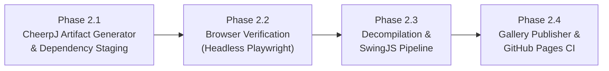

# Provikom Converter - Milestone Two Implementation Plan

## 1. Context & Objectives

Milestone One established the standalone analyzer, zero-execution JVM bytecode parser, security guards, backend adapter contracts, JSON report schema, and full audit of all seven games in `project-2024`.

**Milestone Two Goal:** Transition from *analysis-only* to *automated web artifact generation and verification*, delivering both an immediate production CheerpJ publishing pipeline and an open-source transpilation pathway.

---

## 2. Core Workstreams for Milestone Two

### Workstream A: Production CheerpJ Artifact Generator
1. **Automated Bundle Synthesis**:
   - Implement `CheerpJAdapter.generate_bundle(analysis, options)`:
     - Emits a responsive, accessible HTML5 game viewer shell.
     - Injects CheerpJ 5.0 loader and initialization code.
     - Adds user-gesture audio unlocker to comply with modern browser autoplay policies.
     - Generates canvas mounting with DPI scaling support.
2. **Automated Dependency Staging**:
   - Automatically resolve and stage `Class-Path` entries (e.g., `lib/AbsoluteLayout.jar`).
   - Automatically mount auxiliary JARs via `cheerOSAddStringFile` before launching the main entry class.
3. **Gallery Catalog Generator**:
   - Command `provikom-converter publish-gallery <catalog.json|dir> -o <dist>` generating a complete static game gallery matching or exceeding the capabilities of `project-2024`.

---

### Workstream B: Open-Source Transpilation Pathway (SwingJS & Decompilation)
1. **Decompilation Pipeline**:
   - Integrate an isolated Java decompiler (CFR or Fernflower).
   - Decompile untrusted bytecode into Java source files in an ephemeral sandboxed container.
2. **Java Version Downleveling**:
   - Modern games in the gallery use Java 21/22 features or bytecode versions.
   - Implement source transformation/downgrade rules to normalize decompiled code to Java 8/11 source syntax accepted by SwingJS.
3. **Java2Script Headless Transpilation**:
   - Package a headless Java2Script transpiler invocation generating static `.js` files and bundling `swingjs2.js`.
   - Benchmark performance, startup time, and memory versus CheerpJ.

---

### Workstream C: Experimental TeaVM Canvas Adapter
1. **Feasibility Assessment**:
   - For simple canvas/graphics games (e.g., `PongGame` and `Snake Game FinPro`), assess feasibility of providing a lightweight `java.awt.Graphics2D` -> HTML5 Canvas bridge.
   - If feasible, prototype an AWT stub library for TeaVM.

---

### Workstream D: Sandboxed Browser Verification Harness
1. **Headless Playwright / Puppeteer Test Suite**:
   - Run generated web artifacts inside a headless Chromium instance.
   - Assert:
     - No uncaught JavaScript exceptions during initialization.
     - Canvas element acquires expected dimensions.
     - First frame renders within timeout threshold (< 10 seconds on CheerpJ).
2. **Automated CI Workflow**:
   - Run tests on ephemeral GitHub-hosted runners (`ubuntu-latest`).
   - Strict ban on self-hosted runners on lab VMs for untrusted game PRs.

---

## 3. Implementation Phasing & Milestones

### Phase 2.1: CheerpJ Bundle Generator (2 Weeks)
- Implement `provikom-converter convert <jar> --backend cheerpj -o ./dist`.
- Support responsive viewport, full-screen toggle, audio activation banner, and loading state.
- Automated dependency bundling (e.g. `AbsoluteLayout.jar`).

### Phase 2.2: Headless Browser Verification (1 Week)
- Add Playwright integration tests checking canvas initialization and console error monitoring.

### Phase 2.3: SwingJS Decompiler & Transpiler (3 Weeks)
- Integrate CFR decompiler in sandbox mode.
- Test decompilation and transpilation on `PaddleGame.jar` (Java 8 baseline) and `flappy.jar`.

### Phase 2.4: Gallery Publisher & CI Deployment (1 Week)
- `provikom-converter build-gallery` command.
- GitHub Actions workflow deploying verified static artifacts directly to GitHub Pages.

---

## 4. Acceptance Criteria for Milestone Two

1. `provikom-converter convert <jar> --backend cheerpj -o <dist>` generates a complete, static HTML/JS folder that can be served via any HTTP static server (e.g., `python3 -m http.server 8080`).
2. Running the command on `PaddleGame.jar` automatically copies `AbsoluteLayout.jar` and registers it in `script.js` without manual editing.
3. Automated headless browser test passes for all 7 games, verifying canvas mounting and zero unhandled errors.
4. Clean documentation and CLI help for the new conversion flags.
